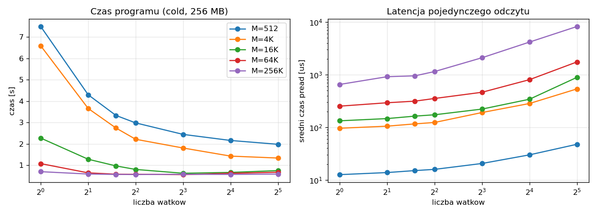
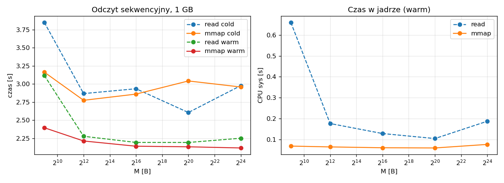
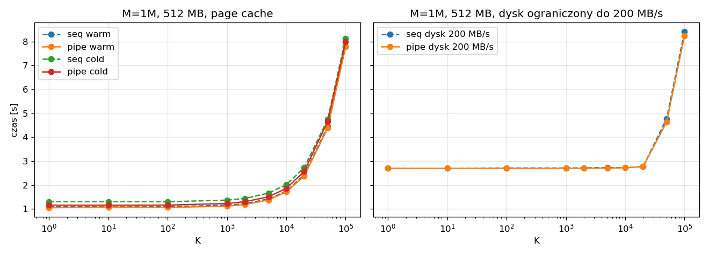
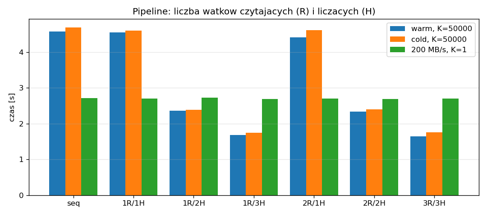

# Sprawozdanie – laboratorium 1

Środowisko: VM Debian 12, 3 vCPU, 3.8 GB RAM, dysk QEMU. Każdy wynik to minimum z 3 - 5 uruchomień. "Cold" to `drop_caches` przed każdym uruchomieniem, "warm" to plik w page cache. Dodatkowo część pomiarów zrobiłem z limitem `IOReadBandwidthMax=200M`, bo dysk VM jest bardzo szybki (cache hosta).

Uruchamianie: `make all`, `make bench`, `make plots`. Wyniki są w `results/`.

## Latencja

| M | 1 wątek | 32 wątki | średni pread (1 → 32 wątki) |
|---|---|---|---|
| 512 B | 7.50 s | 1.98 s | 13 → 48 µs |
| 4 KB | 6.59 s | 1.33 s | 96 → 538 µs |
| 64 KB | 1.07 s | 0.67 s | 253 → 1752 µs |

Plik 256 MB, cold.

- **Czas w funkcji M i liczby wątków:** wykres i tabela powyżej.
- **Czy więcej wątków zmniejsza czas?** Tak, dla małych M (4 - 5x). Od M ok. 16 - 64 KB czas zatrzymuje się na ok. 0.56 s i dalsze wątki nic nie dają.
- **Czy więcej wątków zmniejsza latencję odczytu?** Nie, latencja pojedynczego odczytu rośnie.
- **File cache:** odczyt 512 B trwa ok. 1 µs zamiast 13 µs. Czas programu (ok. 1 s dla M=512, 0.53 s dla dużych M) prawie nie zależy wtedy od liczby wątków.

## Przepustowość (mmap)

| M | read cold | mmap cold | read warm | mmap warm |
|---|---|---|---|---|
| 512 B | 3.85 s | 3.16 s | 3.12 s | 2.40 s |
| 4 KB | 2.87 s | 2.78 s | 2.28 s | 2.21 s |
| 1 MB | 2.61 s | 3.04 s | 2.19 s | 2.13 s |

Plik 1 GB, odczyt sekwencyjny.

- **Czas w funkcji M:** przy M=512 `mmap` jest o ok. 20% szybszy. Od 4 KB obie wersje mają podobny czas.
- **Kiedy mmap mniej obciąża CPU?** Przy czytaniu małymi blokami: czas sys spada z 0.66 s do 0.07 s (warm, M=512). Przy dużych blokach różnica jest mała (0.10 - 0.19 s wobec 0.06 - 0.08 s).
- **File cache:** czas spada o ok. 25% (z ok. 2.9 do 2.15 s). Przy limicie pamięci 512 MB i pliku 1 GB czasy są prawie jak w cold, a `mmap` jest trochę wolniejszy od `read` (3.1–3.2 s wobec 2.7–2.9 s).

## Pipelining

| K | warm | cold | dysk 200 MB/s |
|---|---|---|---|
| 1 | 1.09 / 1.05 | 1.30 / 1.16 | 2.71 / 2.70 |
| 2 000 | 1.22 / 1.18 | 1.44 / 1.30 | 2.72 / 2.70 |
| 20 000 | 2.42 / 2.37 | 2.72 / 2.57 | 2.77 / 2.77 |
| 100 000 | 7.79 / 7.79 | 8.13 / 7.99 | 8.42 / 8.25 |

Plik 512 MB, M = 1 MB, czasy seq / pipe w sekundach. seq – oryginalna wersja jednowątkowa, pipe – wątek czytający + wątek liczący połączone `sync_channel`.

- **Czas w funkcji M i K:** do K ok. 1000 czas jest prawie stały, potem rośnie liniowo z K. Pipe jest szybszy od seq o ok. 0.04 s (warm) i 0.15 s (cold). Dla małych M (4 KB) pipe jest wolniejszy od seq (warm, K=100: 3.44 s wobec 2.86 s). Od M >= 256 KB czas prawie nie zależy od M.
- **K_opt dla M = 1 MB:**
  - plik w pamięci: ok. 1000 - 2000,
  - plik czytany z dysku (cold, także z `MemoryMax=256M`): ok. 1000,
  - dysk ograniczony do 200 MB/s: ok. 20 000.

- **Czy więcej wątków coś zmienia?**
  - Więcej wątków czytających: nie.
  - Więcej wątków liczących: tak, prawie liniowo do liczby rdzeni (warm, K = 50 000: 4.55 → 2.36 → 1.68 s dla 1/2/3 wątków). Nie pomaga, gdy ogranicza dysk (200 MB/s, K = 1: wszystkie konfiguracje ok. 2.7 s).
  - Rozmiar kanału nie ma znaczenia.

---

Skrypty do benchmarków i wykresów (`scripts/bench_*.py`, `scripts/run_all_benchmarks.sh`, `scripts/plots.py`) zostały napisane z pomocą AI.
